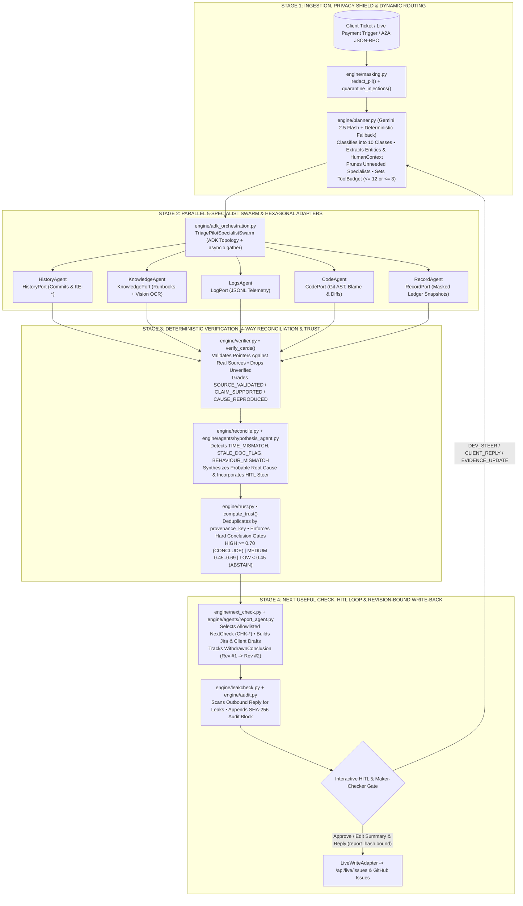

# TriagePilot™ — Production Readiness, End-to-End Codeflow & 3-Minute Demo Playbook

> **Tagline:** *"Every conclusion ships with proof, or it doesn't ship."*  
> **Track:** Future of Work & Enterprise Productivity (Google Cloud AI Builder Cup 2026)  
> **Live Cloud Run Service:** [https://triagepilot-ywgad5nv3a-uc.a.run.app](https://triagepilot-ywgad5nv3a-uc.a.run.app)  
> **Verification Status:** `205 / 205` Pytest Suite Passing (`100%`) • `8 / 8` Golden Scenarios Verified (`100%`) • Live Multi-Turn HITL & Git Code Studio Verified

---

## 1. Executive Readiness Checklist

| Readiness Dimension | Implementation Module(s) | Status & Verification Proof |
| :--- | :--- | :--- |
| **1. Pre-LLM Privacy & Injection Shield** | [`engine/masking.py`](engine/masking.py) | Deterministic regex redaction of Account Numbers, PAN, IFSC, Phone, Email, and Aadhaar before any LLM call; prompt-injection strings quarantined (`[INJECTION_QUARANTINED]`) in both tickets (`S03`) and logs (`S04`). |
| **2. Intelligent Routing & 12-Call Tool Budget** | [`engine/planner.py`](engine/planner.py), [`engine/tool_budget.py`](engine/tool_budget.py) | Dynamic classification across 10 incident classes (`CODE_DEFECT`, `DATA_ISSUE`, `KNOWN_ERROR`, `HOW_TO_USER_ERROR`, `INSUFFICIENT_INFO`, `SECURITY_SENSITIVE`, etc.); prunes unneeded specialists and enforces a hard 12-call budget (`3` on `INSUFFICIENT_INFO`). |
| **3. Parallel 5-Specialist Swarm + ADK Topology** | [`engine/adk_orchestration.py`](engine/adk_orchestration.py), [`engine/agents/specialists.py`](engine/agents/specialists.py) | Google ADK-compatible `ParallelAgent` topology (`TriagePilotSpecialistSwarm`) with deterministic concurrent execution (`asyncio.gather`) across `HistoryAgent`, `KnowledgeAgent` (+ Gemini Vision OCR), `LogsAgent`, `CodeAgent`, and `RecordAgent`. |
| **4. Live Target Service & In-Browser Live Code Studio** | [`engine/adapters/live_adapter.py`](engine/adapters/live_adapter.py), [`transfers-demo-app/app/`](transfers-demo-app/app) | Direct browser/IDE editing of `daily_limit.py`, `cutoff.py`, `calculator.py`, and `sms.py`; commits to an isolated Git mirror (`data/live/clientrepo`) with a real 40-char SHA, auto-runs a live probe payment, and verifies exact changed lines. |
| **5. Deterministic Verifier & 3-Tier Evidentiary Truth** | [`engine/verifier.py`](engine/verifier.py) | Verifies every pointer against real files/SHAs/lines (`code:path@sha:start-end`), JSONL logs (`<= 1s` tolerance), `HistoryPort` tickets, runbooks, and masked records. Drops unverified citations on the spot and grades **`SOURCE_VALIDATED`**, **`CLAIM_SUPPORTED`**, and **`CAUSE_REPRODUCED`**. |
| **6. 4-Way Reality Cross-Examination** | [`engine/reconcile.py`](engine/reconcile.py), [`engine/agents/hypothesis_agent.py`](engine/agents/hypothesis_agent.py) | Cross-examines **Client Claim** vs. **Logs/Ledger** vs. **Pinned Git Code** vs. **Runbooks**, flagging `TIME_MISMATCH`, `STATE_MISMATCH`, `CHANGE_MISMATCH`, `STALE_DOC_FLAG`, `BEHAVIOUR_MISMATCH`, and `SCOPE_MISMATCH`. |
| **7. Provenance-Deduplicated Trust & Hard Gates** | [`engine/trust.py`](engine/trust.py), [`engine/policy.py`](engine/policy.py) | Mathematical trust score $T \in [0, 1]$ deduplicated by `provenance_key`; never uses LLM self-confidence. Enforces 4 hard gates (`REPRODUCED_IN_FIXTURE`, `SUPPORTED_HYPOTHESIS`, `NEED_EVIDENCE`, `BLOCKED`) and **Principled Abstention** when $T < 0.45$. |
| **8. Interactive Multi-Turn HITL Loop & Withdrawal** | [`engine/orchestrator.py`](engine/orchestrator.py), [`engine/next_check.py`](engine/next_check.py), [`engine/agents/report_agent.py`](engine/agents/report_agent.py) | Supports **`DEV_STEER`** (natural-language engineer steer/confirmation), **`CLIENT_REPLY`** (resume after abstention), and **`EVIDENCE_UPDATE`** (withdraws prior conclusion via `WithdrawnConclusion`, increments `report_revision`, and invalidates stale approvals). |
| **9. Revision-Bound Maker-Checker & Inline Draft Edits** | [`api/main.py`](api/main.py), [`engine/leakcheck.py`](engine/leakcheck.py) | Operators can edit the Investigation Summary and Customer Reply inline; backend re-runs `leakcheck.py`, recomputes `report_hash`, binds approval to `report_revision` + `report_hash`, and persists to `/api/live/issues` (and GitHub Issues when configured). |
| **10. Google A2A v0.2 & SHA-256 Hash-Chained Audit** | [`api/a2a.py`](api/a2a.py), [`engine/audit.py`](engine/audit.py) | Standards-compliant Agent Card at `GET /.well-known/agent.json`, JSON-RPC 2.0 `tasks/send` at `POST /a2a`, and a Firestore-backed SHA-256 hash-chained audit ledger (`GET /api/audit/verify`). |

---

## 2. Complete End-to-End Codeflow (How TriagePilot™ Actually Works)

### Step-by-Step Code Execution Path

1. **Entrypoint (`api/main.py` $\rightarrow$ `engine/orchestrator.py:InvestigationManager.start_investigation`)**
   - Accepts `InvestigationCreateRequest` (`scenario_id`, `text`, `attachments`, `mode`, `human_context`).
   - Streams every milestone over Server-Sent Events (`GET /api/investigations/{id}/events`) so the UI updates in real time.
2. **Pre-LLM Guardrails (`engine/masking.py`)**
   - `redact_pii()` deterministically masks bank account numbers (`[ACCT_REDACTED]`), PAN, IFSC, phone numbers, emails, and 12-digit IDs (`[Aadhaar Redacted]`).
   - `quarantine_injections()` neutralizes adversarial instruction overrides (`Ignore previous instructions...`, `SYSTEM OVERRIDE...`) in both ticket text and log payloads before any model sees them.
3. **Dynamic Planner & Human-in-the-Loop Context Processor (`engine/planner.py`)**
   - Calls `plan_investigation()` (using Vertex AI `gemini-2.5-flash` when configured, or deterministic routing fallback).
   - If `human_context` is supplied (`DEV_STEER`, `CLIENT_REPLY`, or `EVIDENCE_UPDATE`), `_process_human_context()` extracts natural-language file/module hints (e.g., mapping `"daily_limit logic"` $\rightarrow$ `app/limits/daily_limit.py` even without `.py`), elevates `INSUFFICIENT_INFO` when clarified, and activates the exact specialist agents needed to verify the human input.
4. **Parallel 5-Specialist Swarm (`engine/adk_orchestration.py` & `engine/agents/specialists.py`)**
   - Wraps all tool calls in a shared `ToolBudget` (`max_calls=12`, or `3` for `INSUFFICIENT_INFO`).
   - Runs active specialists concurrently via `asyncio.gather`:
     - **`HistoryAgent`**: Queries `HistoryPort` (`LiveGitHistoryAdapter` / `FixtureHistoryAdapter`) for recent Git commits (`CHG-LIVE-*`), known errors (`KE-104`), and historical incidents (`INC-*`), verifying cited ticket content.
     - **`KnowledgeAgent`**: Queries `KnowledgePort` for canonical SOP runbooks (`DOC-LIMITS-01`, `DOC-CUTOFF-01`, `DOC-FEES-01`, `DOC-SMS-01`, `DOC-IDEMPOTENCY-01`, `DOC-BEN-02`) and runs **Gemini 2.5 Flash Vision OCR** on attached error screenshots (`S06`).
     - **`LogsAgent`**: Queries `LogPort` (`data/live/logs.jsonl` or scenario bundle) for structured error traces, scrubbing any log-embedded prompt injections.
     - **`CodeAgent`**: Queries `CodePort` (`LiveGitCodeAdapter` / `FixtureCodeAdapter`) to inspect pinned Git AST/lines at `HEAD` SHA, unified diffs (`get_recent_diff_hits`), and blame metadata. Prioritizes executable statements (`if `, `raise `, `return `) over docstring prose.
     - **`RecordAgent`**: Queries `RecordPort` (`data/live/records.json` or fixture records) for PII-masked transaction ledger snapshots (`TXN-*`).
5. **Deterministic Verifier & 3-Tier Evidentiary Truth Classifier (`engine/verifier.py`)**
   - Every `EvidenceCard` returned by specialists is checked by deterministic Python code against the underlying adapter:
     - Code cards must match the actual file, line range, and 40-char commit SHA (`code:app/limits/daily_limit.py@61b344d...:26-32`).
     - Log cards must match `log_id` and timestamp within `<= 1s` (`log:LOG-LIVE-...@ts`).
     - Ticket cards are cross-checked against `HistoryPort.get_ticket()`.
     - Runbook cards are validated against `KnowledgePort.get_doc_section()`.
   - Unverified citations are immediately moved to `dropped_cards`.
   - Verified cards are assigned a `provenance_key` and graded into:
     - **`SOURCE_VALIDATED`**: Source exists at the cited SHA/line, but does not by itself prove causal mechanism (e.g., an innocent `httpx` bump in `requirements.txt`).
     - **`CLAIM_SUPPORTED`**: Directly supports the behavioral/policy claim.
     - **`CAUSE_REPRODUCED`**: Code defect is corroborated by matching runtime logs and ledger state for the same transaction/symptom.
6. **4-Way Reality Reconciler & Hypothesis Synthesizer (`engine/reconcile.py` & `engine/agents/hypothesis_agent.py`)**
   - `reconcile.py` deterministically computes `TIME_MISMATCH` ($|\text{client\_ts} - \text{log\_ts}| > 30\text{ min}$), `STATE_MISMATCH`, `CHANGE_MISMATCH`, and `STALE_DOC_FLAG` ($\text{doc.last\_updated} < \text{commit.date}$).
   - `HypothesisAgent` consumes *only* `verified_cards` + contradiction flags, filters out non-causal `SOURCE_VALIDATED` noise when causal code cards exist, detects semantic `BEHAVIOUR_MISMATCH`, incorporates any `DEV_STEER` / `CLIENT_REPLY` / `EVIDENCE_UPDATE` feedback, and detects `[LIVE GIT FIX VERIFIED]` when a developer commit resolves a live runtime failure.
7. **Provenance-Deduplicated Trust Engine & Policy Gate (`engine/trust.py` & `engine/policy.py`)**
   - Computes:
     $$\text{Score} = \text{clamp}\bigl(0.40\cdot c_{\text{ver}} + 0.25\cdot c_{\text{div}} + 0.20\cdot c_{\text{spec}} + 0.15\cdot c_{\text{time}} - 0.30\cdot p_{\text{contra}} - 0.20\cdot p_{\text{unver}},\; 0,\; 1\bigr)$$
     where $c_{\text{ver}}$ is computed over **unique `provenance_key`s** so duplicate citations to the same line/log cannot inflate trust.
   - Enforces hard gates:
     - `HIGH` ($\ge 0.70$) $\rightarrow$ `CONCLUDE` (`REPRODUCED_IN_FIXTURE` or `SUPPORTED_HYPOTHESIS`)
     - `MEDIUM` ($0.45\text{–}0.69$) $\rightarrow$ `CONCLUDE_WITH_CAVEAT`
     - `LOW` ($< 0.45$ or top-2 hypothesis gap $< 0.10$) $\rightarrow$ `ABSTAIN` (`NEED_EVIDENCE` / `BLOCKED`)
8. **Allowlisted Next Check, Report Synthesis & Cryptographic Audit (`engine/next_check.py`, `engine/agents/report_agent.py`, `engine/audit.py`)**
   - `select_next_check()` picks the highest-leverage next diagnostic action (`CHK-BOUNDARY-CONTROL-DIFF`, `CHK-STEER-DIRECTIVE-VERIFIED`, `CHK-LIVE-FIX-VERIFIED`, `CHK-CLARIFY-CLIENT`, etc.).
   - `ReportAgent` builds the structured `ReportOutput` (`summary`, `customer_reply_draft`, `jira_draft`, `withdrawn_conclusion`, `report_revision`, `report_hash`).
   - `leakcheck.py` verifies zero internal file paths or stack traces leak into `customer_reply_draft` (and re-runs whenever an operator edits the draft prior to approval).
   - `audit.py` seals every transition into a SHA-256 hash chain (`prev_hash` $\rightarrow$ `hash`).

---

## 3. Why TriagePilot™ Is Unique & Best-in-Class

1. **Zero Hallucinated Citations by Construction:** The LLM cannot invent a file path, line number, commit SHA, or log ID that reaches the final report—`verifier.py` checks every pointer deterministically against the adapter and drops anything unverified before synthesis.
2. **Causal Proof vs. Mere Pointer Existence (`3-Tier Truth`):** Standard RAG/agent tools treat any real commit as "proof." TriagePilot™ separates `SOURCE_VALIDATED` (e.g., an innocent `httpx` version bump in `S06`) from `CAUSE_REPRODUCED` (the `>=` boundary check in `app/limits/daily_limit.py:29` corroborated by `TXN-6001` logs and `DOC-LIMITS-01`).
3. **True Closed-Loop Live Code Studio & Interactive HITL:** Judges don't just click static replays. They can trigger a failing payment, watch the swarm pinpoint `app/limits/daily_limit.py:29`, enter natural-language developer feedback in the **Interactive HITL Loop** (`Steer Swarm`), edit `>=` to `>` directly in the **Live Code Studio**, commit a real Git SHA, and watch TriagePilot™ verify `[LIVE GIT FIX VERIFIED]` with a live passing transaction.
4. **Principled Abstention & Contradictory Evidence Withdrawal:** Knows when *not* to guess (`S11` abstains at `0.22 LOW` trust and asks 2 discriminating questions), and when late-arriving telemetry contradicts an earlier conclusion (`EVIDENCE_UPDATE`), it explicitly withdraws `Rev #1` (`WithdrawnConclusion`), issues `Rev #2`, and blocks stale approvals on `Rev #1`.
5. **Quantified, Reproducible Advantage Over Single-Agent Baseline:** Includes a runnable head-to-head benchmark (`eval/runner.py` & `eval/ablations.py`) showing **100% Root-Cause Hit Rate (`8/8`) vs. 50% Single-Agent Baseline**, **0.0% False Conclusion Rate vs. 50.0%**, and **100% Prompt Injection Defense (`2/2`)**.

---

## 4. Practical Live Test Case Scenarios (Step-by-Step)

### Practical Scenario A (Signature 3-Turn End-to-End Live Flow):
**Client Bug Report $\rightarrow$ Triage Swarm Pinpoints `daily_limit.py:29` $\rightarrow$ Dev HITL Confirmation $\rightarrow$ Live Code Fix (`>=` to `>`) Verified**

1. **Turn 1 — Client Reports Broken Boundary Logic & Swarm Pinpoints Exact Line:**
   - Open **Investigate Incident** $\rightarrow$ switch source to **`Live App`** (or select **`S03: Daily Limit Boundary >= Bug`** in the Live Payment Simulator) and click **`Trigger & Auto-Triage in Cockpit`** (Amount: `INR 100,000`).
   - **What Happens:** The live transfer fails with `DailyLimitExceededError: Daily limit of ₹100,000.00 exceeded for request of ₹100,000.00` even though prior daily spend is `₹0.00`.
   - **Swarm Output:**
     - **Probable Root Cause:** `Root cause in app/limits/daily_limit.py: Code match in app/limits/daily_limit.py:29 — if transfer_amount >= DAILY_TRANSFER_LIMIT:`
     - **Culprit Files:** `['app/limits/daily_limit.py']` (graded **`CAUSE_REPRODUCED`**)
     - **Next Useful Check:** `CHK-BOUNDARY-CONTROL-DIFF` (*Compare Failed Boundary Transfer (INR 1,00,000) Against Sub-Boundary Control (INR 99,999.99) on Same Release*)
2. **Turn 2 — Developer Enters Natural-Language Confirmation in the HITL Loop (`Steer Swarm`):**
   - In the middle column under **Interactive HITL Loop**, click **`Steer Swarm`** (`DEV_STEER`) and type:
     > `I checked daily_limit logic and confirmed line 29 uses >= instead of > against DAILY_TRANSFER_LIMIT. Please confirm runbook DOC-LIMITS-01 and prepare the fix recommendation.`
   - Click **`Re-Investigate with Context`**.
   - **Swarm Output (All Right-Side Panels Update Dynamically):**
     - **Probable Root Cause:** `[HITL ENGINEER CONFIRMATION: "I checked daily_limit logic and confirmed line 29 uses >= instead of > against DAILY_TRANS"] Verified root cause in app/limits/daily_limit.py: Code match in app/limits/daily_limit.py:29 — if transfer_amount >= DAILY_TRANSFER_LIMIT:`
     - **Next Useful Check:** `CHK-STEER-DIRECTIVE-VERIFIED` (*Engineer Steer Executed: Re-Evaluated Swarm Against 'I checked daily_limit logic and confirmed...'*)
     - **Evidence Trust Gate:** `Interactive HITL (DEV_STEER): Swarm re-steered by engineer (...) -> 0.76 (HIGH / CONCLUDE)`
     - **Customer Reply & Jira Draft:** Automatically updated with the confirmed remediation plan; operator can also click **Edit Drafts** to customize the Summary/Reply and click **Approve & Write-Back**.
3. **Turn 3 — Developer Fixes `>=` to `>` in Live Code Studio & Swarm Verifies the Fix:**
   - Click **`Live App`** tab $\rightarrow$ in **Live Code Studio**, select `app/limits/daily_limit.py`, change `if transfer_amount >= DAILY_TRANSFER_LIMIT:` (and `if new_total >= DAILY_TRANSFER_LIMIT:`) to `>`, and click **`Commit & Triage in Cockpit`**.
   - **What Happens:** `update_and_commit_live_file()` writes the fix, creates a real Git commit (`@short_sha`), automatically runs a live ₹1,00,000 probe transaction (`COMPLETED`), and launches verification in the Cockpit.
   - **Swarm Output:**
     - **Probable Root Cause:** `[LIVE GIT FIX VERIFIED] Developer commit @<sha> in app/limits/daily_limit.py resolved the boundary defect (Live Git Edit app/limits/daily_limit.py:29 — from if transfer_amount >= DAILY_TRANSFER_L -> if transfer_amount > DAILY_TRANSFER_LIMIT:). Live payment completed with zero policy contradictions.`
     - **Next Useful Check:** `CHK-LIVE-FIX-VERIFIED` (*Live Git Fix Verified: Boundary Transfer Succeeded Against Policy*)

---

### Practical Scenario B (Safety, Abstention & Contradictory Evidence Withdrawal):
**Underspecified Ticket (`S11`) $\rightarrow$ Principled Abstention $\rightarrow$ Client Reply Resume $\rightarrow$ Contradictory Evidence Withdrawal (`Rev #1` $\rightarrow$ `Rev #2`)**

1. **Pass 1 — Principled Abstention on Vague Ticket (`S11`):**
   - Select **`S11`** (*"Transfers not working urgently"*) from the Queue and click **`Run Triage`**.
   - **Swarm Output:** Planner caps tool budget at `3` calls. Trust scores **`0.22 LOW`** (`GATE: NEED_EVIDENCE`), policy selects **`ABSTAIN`**, locks Write-Back, selects **`CHK-CLARIFY-CLIENT`**, and generates 2 discriminating questions for the client.
2. **Pass 2 — Client Reply Resume (`CLIENT_REPLY`):**
   - In the **Interactive HITL Loop**, click **`Client Reply`** (`CLIENT_REPLY`), click the quick-fill chip (*"Failed at 4:15 PM IST on same-day transfer TXN-1009 with CUTOFF_EXCEEDED"*), and click **`Re-Investigate with Context`**.
   - **Swarm Output:** Trust jumps from `0.22 LOW` (`ABSTAIN`) to **`0.86 HIGH`** (`CONCLUDE`), pinpointing the UTC vs. IST cutoff bug in `app/transfers/cutoff.py:24` (`CAUSE_REPRODUCED`).
3. **Pass 3 — Contradictory Evidence Withdrawal (`EVIDENCE_UPDATE`):**
   - Switch to the **`New Evidence`** (`EVIDENCE_UPDATE`) tab in the HITL Loop, click the quick-fill contradictory telemetry chip, and click **`Re-Investigate with Context`**.
   - **Swarm Output:** Emits a **`WithdrawnConclusion` banner (`Rev #1` $\rightarrow$ `Rev #2`)**, records the exact prior hash and withdrawal reason, blocks any stale approval against `Rev #1`, and seals the transition in the **SHA-256 Audit Ledger**.

---

## 5. The 3-Minute Winning Pitch Script (Minute-by-Minute Playbook)

> **Total Duration:** `3:00` (`180 seconds`)  
> **Pre-Demo Setup (10 seconds before starting):**  
> 1. Open **[https://triagepilot-ywgad5nv3a-uc.a.run.app](https://triagepilot-ywgad5nv3a-uc.a.run.app)** on the **Cockpit** screen.  
> 2. Ensure the Live Workspace is at baseline (click **`Reset Baseline`** in `Live App` if you tested earlier).

---

### ⏱️ Minute 0:00 – 0:40 | How to Start: The Hook, The Problem & The Core Rule (40s)

**What to Show on Screen:**
- Start on the **Cockpit** screen. Point briefly to the top telemetry badges (`Vertex AI • Gemini 2.5`, `ADK • A2A v0.2`, `SHA-256 Audit Chain`) and the 3-column layout (**Left:** Incident Queue & Live Trigger, **Middle:** 4-Way Reality Cross-Check & Interactive HITL Loop, **Right:** Verified Root Cause, Next Useful Check & Evidentiary Trust Gate).

**What to Say (Verbatim Pitch):**
> *"Hi everyone — in enterprise fintech and production engineering, when a critical incident hits, teams get trapped in the L1-to-L3 escalation waterfall. Support escalates vague tickets, operations digs through logs and outdated runbooks, and engineers get paged to hunt through Git commits from scratch.*
>
> *Standard LLM copilots fail here because they hallucinate file paths, trust stale documentation over actual code, and fall for prompt injections hidden inside tickets or logs.*
>
> *That's why we built **TriagePilot™** — an autonomous incident analyst governed by one strict rule: **Every conclusion ships with proof, or it doesn't ship.** Every claim must be deterministically verified against real Git SHAs, line numbers, JSONL logs, runbooks, and masked ledger records before a human ever approves write-back."*

---

### ⏱️ Minute 0:40 – 2:00 | Live Demo Case #1: Client Bug $\rightarrow$ Triage Swarm $\rightarrow$ Dev HITL Loop $\rightarrow$ Live Code Fix Verified (80s)

**What to Do & Show on Screen:**
1. **(0:40 – 1:05) Turn 1 — Trigger the Client Bug:**
   - Click the **`Live App`** tab in the top navigation (or left source selector).
   - Under **1-Click Scenario Presets**, click **`S03: Daily Limit Boundary >= Bug`** (`INR 100,000`) and click **`Trigger & Auto-Triage in Cockpit`**.
   - Point to the **Right Column** as the 5-specialist swarm finishes in seconds: it pinpoints **`app/limits/daily_limit.py:29`** (`if transfer_amount >= DAILY_TRANSFER_LIMIT:`), grades it **`CAUSE_REPRODUCED`**, cross-checks Runbook **`DOC-LIMITS-01`** in the **4-Way Reality Matrix**, and recommends **`CHK-BOUNDARY-CONTROL-DIFF`**.
2. **(1:05 – 1:30) Turn 2 — Interactive Developer HITL Loop (`Steer Swarm`):**
   - In the **Middle Column** under **Interactive HITL Loop**, click **`Steer Swarm`** (`DEV_STEER`), click/type:
     *"I checked daily_limit logic and confirmed line 29 uses >= instead of > against DAILY_TRANSFER_LIMIT. Please confirm runbook DOC-LIMITS-01 and prepare the fix recommendation."*
   - Click **`Re-Investigate with Context`**.
   - Point to the **Right Column**: show how **Probable Root Cause** updates with `[HITL ENGINEER CONFIRMATION]`, **Next Useful Check** transitions to **`CHK-STEER-DIRECTIVE-VERIFIED`**, and **Evidence Trust Gate** logs the interactive engineer steer (`0.76 HIGH / CONCLUDE`).
3. **(1:30 – 2:00) Turn 3 — Fix the Code Live (`>=` $\rightarrow$ `>`) & Verify:**
   - Click **`Live App`** $\rightarrow$ in **Live Code Studio** (`app/limits/daily_limit.py`), change `>=` to `>` on the `DAILY_TRANSFER_LIMIT` check and click **`Commit & Triage in Cockpit`**.
   - Point to the **Right Column**: TriagePilot™ commits a brand-new 40-character Git SHA, automatically executes a live ₹1,00,000 probe transfer (`COMPLETED`), and updates the conclusion to **`[LIVE GIT FIX VERIFIED]`** with **`CHK-LIVE-FIX-VERIFIED`**!

**What to Say (Verbatim Pitch):**
> *"Let's see this live—not a canned replay. A client tries to transfer ₹1,00,000 and gets blocked by a `DailyLimitExceededError` even though their prior spend today is ₹0. We trigger the live transaction and TriagePilot's 5-specialist swarm cross-examines the client claim, live JSONL logs, masked ledger record, runbook `DOC-LIMITS-01`, and Git AST—pinpointing line 29 of `app/limits/daily_limit.py` where `>=` was used instead of `>`, graded `CAUSE_REPRODUCED`.*
>
> *Now watch the **Human-in-the-Loop** connection: as the on-call developer, I type in plain English in **`Steer Swarm`** that I confirmed the `>=` check and want the remediation prepared. When I click **Re-Investigate**, the swarm re-evaluates and dynamically updates the Root Cause Verdict, switches the **Next Useful Check** to `CHK-STEER-DIRECTIVE-VERIFIED`, updates the **Trust Gate**, and drafts the Jira issue and customer reply.*
>
> *Even better—let's fix the bug right now in the **Live Code Studio** by changing `>=` to `>` and clicking **Commit & Triage**. TriagePilot commits the change to Git with a new SHA, automatically runs a live ₹1,00,000 probe payment, and verifies **`[LIVE GIT FIX VERIFIED]`**!"*

---

### ⏱️ Minute 2:00 – 3:00 | Live Demo Case #2: Principled Abstention, Conclusion Withdrawal & 100% Benchmark Proof (60s)

**What to Do & Show on Screen:**
1. **(2:00 – 2:30) Scenario `S11` + Contradictory Evidence Withdrawal + Maker-Checker Approval:**
   - Select **`S11`** from the Queue (*"Transfers not working urgently"*): show how TriagePilot™ scores **`0.22 LOW`**, triggers **Principled Abstention** (`ABSTAIN`), locks Write-Back, and asks 2 clarifying questions (`CHK-CLARIFY-CLIENT`).
   - Click **`Client Reply`** $\rightarrow$ send the client's clarification (`TXN-1009 at 4:15 PM IST`) $\rightarrow$ show it resolving `app/transfers/cutoff.py` (`TIME_MISMATCH` caught!).
   - Click **`New Evidence`** (`EVIDENCE_UPDATE`) to demonstrate **`WithdrawnConclusion` (`Rev #1` $\rightarrow$ `Rev #2`)**, or click **`Approve & Write-Back`** (showing inline editing of Summary/Customer Reply with post-edit `LeakCheck` and `report_hash` binding).
2. **(2:30 – 3:00) Evaluation & Benchmark Proof (`8/8` vs. Single-Agent Baseline):**
   - Click **`Eval Suite`** in the top bar. Point to the **100% Root-Cause Hit Rate (`8/8`)**, **0.0% False Conclusion Rate** (vs. `50.0%` Single-Agent Baseline), **100% Prompt Injection Defense** (`S03` ticket injection + `S04` log injection), **Google A2A v0.2 interoperability**, and the **SHA-256 Hash-Chained Audit Ledger**.

**What to Say (Verbatim Pitch):**
> *"What if a ticket doesn't have enough evidence, like `S11` ('Transfers not working urgently')? Instead of guessing like a standard chatbot, our provenance-deduplicated trust engine scores `0.22 LOW`, triggers **Principled Abstention**, locks write-back, and asks two targeted questions. When the client replies, Turn 2 resolves the exact UTC-vs-IST cutoff bug in `cutoff.py` while catching a 31-hour `TIME_MISMATCH` in the client's claim.*
>
> *And if contradictory telemetry arrives later via **`New Evidence`**, TriagePilot explicitly **withdraws Revision #1**, issues **Revision #2**, invalidates stale approvals, and seals every step in a **Firestore SHA-256 hash-chained audit ledger**.*
>
> *Across our 205 automated tests and 8 golden evaluation scenarios—including multimodal Gemini Vision OCR on `S06` and adversarial prompt injections on `S03` and `S04`—TriagePilot achieves **100% root-cause accuracy and 0% false conclusions**, cutting single-agent false conclusions from 50% down to zero. Thank you!"*
