# TriagePilot™ — Autonomous Incident Analyst & Verifiable Evidentiary Bridge

> *"Every conclusion ships with proof, or it doesn't ship."*

[](https://triagepilot-ywgad5nv3a-uc.a.run.app)
[](eval/tests/)
[](engine/)
[](https://triagepilot-ywgad5nv3a-uc.a.run.app/api/audit/verify)

- **Live Production URL:** [https://triagepilot-ywgad5nv3a-uc.a.run.app](https://triagepilot-ywgad5nv3a-uc.a.run.app)
- **Interactive Walkthrough Guide:** [`DEMO_WALKTHROUGH.md`](DEMO_WALKTHROUGH.md)
- **Architecture Specification:** [`ARCHITECTURE_AND_SPEC.md`](ARCHITECTURE_AND_SPEC.md)

---

## 📌 Overview

In enterprise software and financial infrastructure, incident response is bottlenecked by the **L1 → L2 → L3 escalation waterfall**:
- **L1 Support** receives ambiguous customer tickets (*"transfers failing!"*) and escalates without technical context.
- **L2 Operations** manually correlates distributed logs, transaction ledgers, and often-outdated runbooks.
- **L3 Engineering** is paged to inspect Git commit history and blame lines from scratch.

**TriagePilot™** acts as an autonomous initial analyst and evidentiary bridge. It cross-examines customer claims against operational logs, pinned Git source code, ledger snapshots, visual error screenshots, and runbooks—verifying every citation deterministically in Python before synthesizing a root-cause verdict, customer-safe response, and engineering bug draft.

---

## 🖥️ Triage Command Center UI

```text
+----------------------------------------------------------------------------------------------------------------------------+
|  🧭 TriagePilot™ v1.0 ENTERPRISE   [Triage Command Center]  [Quality & Ablation]  [Architecture & Integration]  [SHA-256]  |
+----------------------------------------------------------------------------------------------------------------------------+
|  10-STAGE VERIFIABLE PIPELINE: [✓ 01 PII Mask] [✓ 02 Flash Router] ... [✓ 06 Pro Hypotheses] ... [10 Maker-Checker]        |
+------------------------------------+-------------------------------------------+-------------------------------------------+
|  COLUMN 1: INCIDENT INGESTION      |  COLUMN 2: SWARM, 4-WAY MATRIX & STREAM   |  COLUMN 3: TRUST, VERDICT & PROOF BOARD   |
|  • Mode: [Queue (8)] | [+ Custom]  |  • Runtime Provenance (Vertex AI Calls)   |  • Mathematical Trust Score:              |
|  • Search & Sort (#1→#8 | P1→P4)   |  • 5-Agent Dynamic Router Bar             |    0.77 HIGH BAND | POLICY: CONCLUDE      |
|    - #1 · TCK-1001 (P1 transfers)  |    [History] [Knowledge] [Logs] [Code]    |  • Verified Root-Cause Verdict:           |
|    - #2 · TCK-2041 (P2 fees)       |    ⚡ PRUNED: RecordAgent                 |    app/transfers/cutoff.py @ 142e868d     |
|    - #3 · TCK-3003 (P1 transfers)  |  • 4-Way Reality Cross-Examination Matrix |  • Sortable & Filterable Evidence Board:  |
|    - #5 · TCK-6006 (P2 Vision OCR) |    1. Client Claim   2. Logs & Ledger     |    [All] [Root-Cause] [Supports] [Dropped]|
|  • Raw Customer Ticket Composer    |    3. Pinned Git AST 4. Runbooks & History|    [All Sources] [Code] [Log] [Doc] [Vis] |
|  • Pre-LLM Gate Preview            |  • Execution Trace Stream (Filterable):   |  • Output Drafts:                         |
|  • Attached UI Screenshot (Vision) |    [All] [Key Stages] [Conflicts & Drops] |    [Customer Reply (LeakCheck: PASSED)]   |
|  • [▶ Run Autonomous Triage]       |  • Maker-Checker Gate / Steer / Follow-Up |    [Jira Bug Draft + Proof Permalinks]    |
+------------------------------------+-------------------------------------------+-------------------------------------------+
```

---

## 📖 How to Use TriagePilot™

### 1. Using the Web Command Center

1. **Open the Command Center:**
   - Visit **[https://triagepilot-ywgad5nv3a-uc.a.run.app](https://triagepilot-ywgad5nv3a-uc.a.run.app)** (or `http://localhost:8080` when running locally).
   - Check the top-right status bar to confirm live backend readiness (`Vertex AI • Gemini 2.5`, `Firestore Native`, and `SHA-256 Ledger` block count).
2. **Ingest an Incident Ticket (Column 1):**
   - **Option A — Ingested Queue (`Queue (8)`):**
     - Filter tickets using the search box or sort via the dropdown (`Sort: #1 → #8`, `Sort: P1 → P4`, `Sort: Class`).
     - Select any ticket (`#1 · TCK-1001` through `#8 · TCK-1111`) to load its raw customer text, metadata, and any attached screenshot (e.g., `#5 · TCK-6006` includes `screenshot.png` for Gemini 2.5 Flash Vision OCR).
   - **Option B — Direct Custom Ticket (`+ Custom`):**
     - Click **`+ Custom`**, select the target service module (`transfers`, `fees`, `notifications`, `limits`, `settlement`), and paste any custom incident description or transaction reference (`TXN-*`, `BATCH-*`).
   - Review the **Pre-LLM Gate Preview** box to see which PII tokens and prompt-injection patterns will be scrubbed in Stage 01.
   - Click **`Run Autonomous Triage`**.
3. **Monitor Live Execution & 4-Way Cross-Examination (Column 2):**
   - Watch the **10-Stage Verifiable Triage Pipeline** bar progress from `01 PII Mask` to `09 SHA-256 Ledger`.
   - Inspect the **Runtime Execution Provenance** card showing each live Gemini call (`ticket_classification`, `multimodal_vision_extraction`, `hypothesis_reconciliation`, `report_synthesis`) with model name and latency in milliseconds.
   - Review the **4-Way Reality Cross-Examination Matrix** comparing `1. Client Claim`, `2. Logs & Ledger State`, `3. Pinned Git AST`, and `4. Runbooks & History`.
   - Filter the **Execution Trace Stream** between `All`, `Key Stages`, and `Conflicts & Drops`.
4. **Inspect Verified Proofs & Trust Breakdown (Column 3):**
   - Click **`Inspect Trust Formula Breakdown`** inside the **Evidentiary Trust Score** card to view the exact positive weights ($c_{\text{ver}}, c_{\text{div}}, c_{\text{spec}}, c_{\text{time}}$) and penalties ($p_{\text{contra}}, p_{\text{unver}}$).
   - Filter the **Verified Evidentiary Cards** board by stance (`All`, `Root-Cause`, `Supports`, `Contradicts`, `Dropped`) or by source (`code`, `log`, `doc`, `record`, `visual`, `ticket`).
   - Click any evidence card (`Inspect Proof`) to open the **Proof Inspector Modal**, showing the exact Git commit SHA, line numbers, snippet, or multimodal screenshot image.
   - Switch between the **Customer Reply** tab (verified by `LeakCheck`) and the **Jira Bug Draft** tab.
5. **Execute Pilot-in-the-Middle & Maker-Checker Actions (Bottom of Column 2):**
   - **Maker-Checker Gate:** Click **`Approve & Commit Write-Back (Jira + Reply)`** (or **`Edit Drafts`** first) to cryptographically bind your approval to `report_revision` and `report_hash`.
   - **Engineer Steer:** Switch to the **`Engineer Steer`** tab to inject domain guidance and re-run the investigation.
   - **Client Follow-Up (Turn-2 Resume):** On underspecified tickets like `#8 · TCK-1111` (`ABSTAIN`), the **`Client Follow-Up`** tab activates automatically. Click **`Ingest Client Clarification & Resume Triage`** to supply the missing transaction ID/timestamp and watch trust jump from `0.22 LOW` (`ABSTAIN`) to `HIGH` (`CONCLUDE`).
6. **Verify Cryptographic Audit Integrity & Run Benchmarks:**
   - Click **`SHA-256 Ledger`** in the top header to inspect every hash-chained block and click **`Re-verify Chain`**.
   - Switch to the **`Quality & Ablation`** tab and click **`Execute Live Verification Suite (8 Incidents)`** to benchmark all 8 incident bundles live.
   - Switch to the **`Architecture & Integration`** tab to inspect the 6 hexagonal port contracts and active `profiles/transfers.yaml` configuration.

---

### 2. Using the REST & SSE API Directly

```bash
# 1. Check service health & Vertex AI / Firestore readiness
curl -fsS https://triagepilot-ywgad5nv3a-uc.a.run.app/healthz
curl -fsS https://triagepilot-ywgad5nv3a-uc.a.run.app/readyz

# 2. List all 8 ingested incident bundles
curl -fsS https://triagepilot-ywgad5nv3a-uc.a.run.app/api/scenarios

# 3. Launch a live investigation (preset scenario S06 with Vision OCR or CUSTOM ticket)
curl -fsS -X POST https://triagepilot-ywgad5nv3a-uc.a.run.app/api/investigations \
  -H "Content-Type: application/json" \
  -d '{"scenario_id": "S06", "mode": "live"}'

# 4. Stream real-time SSE pipeline events (supports Last-Event-ID reconnect cursor)
curl -N https://triagepilot-ywgad5nv3a-uc.a.run.app/api/investigations/INV-xxxxxxxx/events

# 5. Fetch the completed, hash-bound ReportOutput JSON
curl -fsS https://triagepilot-ywgad5nv3a-uc.a.run.app/api/investigations/INV-xxxxxxxx

# 6. Verify the SHA-256 hash-chained audit ledger
curl -fsS https://triagepilot-ywgad5nv3a-uc.a.run.app/api/audit/verify
```

---

## 🏛️ System Architecture

TriagePilot™ uses a **Hexagonal Architecture (Ports and Adapters)** in [`engine/ports/base.py`](engine/ports/base.py), decoupling neuro-symbolic reasoning from external repositories, telemetry, and ticketing systems.

```mermaid
flowchart TD
    subgraph Ingestion ["1. INGESTION & PRE-LLM GUARDRAILS"]
        TKT[("Customer Ticket / Custom Intake")] --> PII["Deterministic PII Scrubber (masking.py)<br/>Masks Accounts, PAN, IFSC, Phone, Email, Aadhaar"]
        PII --> GUARD["Prompt-Injection Quarantine<br/>Neutralizes Untrusted Instruction Overrides"]
    end

    subgraph Core ["2. INTELLIGENT ROUTING & 5-AGENT SWARM"]
        GUARD --> ROUTER["Dynamic Planner (planner.py • Gemini 2.5 Flash)<br/>Classifies Ticket, Enforces 12-Call Tool Budget & Prunes Agents"]
        ROUTER --> S1["HistoryAgent → HistoryPort"]
        ROUTER --> S2["KnowledgeAgent → KnowledgePort + Vision OCR"]
        ROUTER --> S3["LogsAgent → LogPort"]
        ROUTER --> S4["CodeAgent → CodePort (Pinned Git SHA)"]
        ROUTER --> S5["RecordAgent → RecordPort (Masked Snapshots)"]
    end

    subgraph VerifierEngine ["3. DETERMINISTIC VERIFICATION & 4-WAY RECONCILIATION"]
        S1 & S2 & S3 & S4 & S5 --> VERIFIER["Deterministic Python Verifier (verifier.py)<br/>Validates Commit SHAs, Line Ranges, Log IDs & Visual Attachments"]
        VERIFIER --> RECONCILER["4-Way Reconciler (reconcile.py + Gemini 2.5 Pro)<br/>Flags TIME_MISMATCH, STALE_DOC_FLAG & BEHAVIOUR_MISMATCH"]
        RECONCILER --> TRUST["Mathematical Trust Engine (trust.py)<br/>T = clamp(0.40*c_ver + 0.25*c_div + 0.20*c_spec + 0.15*c_time - 0.30*p_contra - 0.20*p_unver)"]
    end

    subgraph HumanGate ["4. REPORT SYNTHESIS, LEAKCHECK & MAKER-CHECKER"]
        TRUST --> POLICY{"Policy Gate (policy.py)<br/>HIGH >= 0.70: CONCLUDE<br/>LOW < 0.45: ABSTAIN"}
        POLICY --> DRAFT["Report Builder (report_agent.py • Gemini 2.5 Flash)<br/>+ Post-Synthesis PII Mask & LeakCheck (leakcheck.py)"]
        DRAFT --> GATE["Revision-Bound Maker-Checker Gate<br/>Binds Approval to report_revision, report_hash & decision_id"]
        GATE --> WRITE["WritePort (Idempotent Jira Issue & Reply Write-Back)"]
    end

    subgraph AuditLog ["5. CRYPTOGRAPHIC AUDITABILITY"]
        Ingestion -.-> AUDIT["Firestore SHA-256 Hash-Chained Audit Ledger (audit.py)"]
        Core -.-> AUDIT
        VerifierEngine -.-> AUDIT
        HumanGate -.-> AUDIT
    end
```



---

## 🎯 Verified Incident Scenarios (`#1` → `#8`)

| # | Ticket ID | Scenario | Severity | Class | Key Verification & Defense Mechanism |
| :--- | :--- | :--- | :--- | :--- | :--- |
| **#1** | `TCK-1001` | **S01:** Same-day transfers rejected after 4 PM IST | `P1` | `CODE_DEFECT` | Flags `TIME_MISMATCH`; pins UTC vs IST bug in `app/transfers/cutoff.py` |
| **#2** | `TCK-2041` | **S02:** Fee off by 0.01 on transfer `TXN-2041` | `P2` | `DATA_ISSUE` | Cross-checks `RecordPort` snapshot with float rounding in `app/fees/calculator.py` |
| **#3** | `TCK-3003` | **S03:** Duplicate debit + Prompt Injection Guard | `P1` | `CODE_DEFECT` | Quarantines ticket prompt injection; identifies missing check in `idempotency.py` |
| **#4** | `TCK-4004` | **S04:** Beneficiary SMS never sent + Stale Runbook | `P2` | `CODE_DEFECT` | Quarantines log injection; flags `STALE_DOC_FLAG` & `BEHAVIOUR_MISMATCH` on `DOC-SMS-01` |
| **#5** | `TCK-6006` | **S06:** Transfer blocked at ₹1,00,000 + Vision OCR | `P2` | `CODE_DEFECT` | Live Gemini 2.5 Flash Vision OCR on `screenshot.png`; pins `>=` bug in `daily_limit.py` |
| **#6** | `TCK-9009` | **S09:** Bank-holiday NEFT settlement delay (`KE-104`) | `P3` | `KNOWN_ERROR` | Fast-path match on `KE-104`; prunes `CodeAgent` and `RecordAgent` |
| **#7** | `TCK-1010` | **S10:** How to add an international beneficiary | `P4` | `HOW_TO_USER_ERROR` | Activates only `KnowledgeAgent` (`DOC-BEN-02`); prunes 4 unnecessary specialists |
| **#8** | `TCK-1111` | **S11:** Underspecified ticket → Abstain → Turn-2 Resume | `P2` | `INSUFFICIENT_INFO` | Turn 1 abstains (`Trust: 0.22`); Turn-2 client clarification resolves `cutoff.py` |

---

## 🚀 Local Setup, Testing & Cloud Run Deployment

### 1. Local Python + Vite Setup
```bash
# 1. Install Python dependencies
pip install -r requirements.txt

# 2. Build the React frontend bundle
cd ui && npm install && npm run build && cd ..

# 3. Start the unified FastAPI + Static UI server on port 8080
python -m uvicorn api.main:app --host 0.0.0.0 --port 8080
```
Or use the convenience scripts:
```powershell
# Windows PowerShell
.\scripts\run_local.ps1

# Linux / macOS
./scripts/run_local.sh
```

### 2. Run the Test & Benchmark Suites
```bash
# Run all 193 backend unit & integration tests
pytest -q

# Run the 8-scenario automated evaluation benchmark
python scripts/run_eval.py

# Verify Python bytecode compilation
python -m compileall -q engine api eval
```

### 3. Deploy to Google Cloud Run
```powershell
# Windows PowerShell
powershell -ExecutionPolicy Bypass -File scripts/deploy_cloudrun.ps1 -ProjectId triagepilot-dev -Region us-central1

# Linux / macOS
GCP_PROJECT_ID=triagepilot-dev ./scripts/deploy_cloudrun.sh
```
